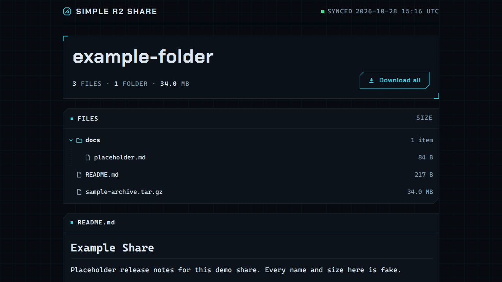
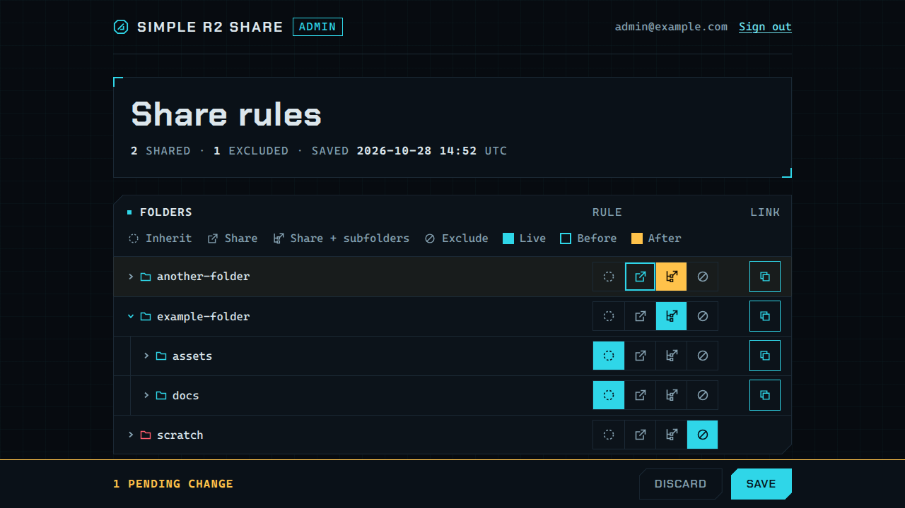

# Simple R2 Share



[[English](README.md) | [正體中文](README.zh.md)]

這是一套公開 [Cloudflare R2](https://developers.cloudflare.com/r2/) 儲存貯體專用的唯讀資料夾分享頁面，透過 Cloudflare Pages Functions 提供服務。使用者在儲存貯體根目錄維護一份規則檔案，列出想要分享的資料夾；這份檔案可以透過受 Cloudflare Access 保護的管理頁，以資料夾樹狀圖編輯。每個分享的資料夾都有一個以短網址 `/s/<token>/` 開啟的頁面，提供可展開的檔案樹狀圖、指向儲存貯體現有公開 URL 的檔案連結，並在下方呈現該資料夾的 `README.md`。系統也支援選用的「全部下載」ZIP 打包下載功能。每份頁面皆在收到請求時從儲存貯體當前內容即時建置，因此更新檔案或規則時無需重新發布或建置。

**功能特點**

- 伺服器端渲染的分享頁面：本身不含 JavaScript，外部圖片請求須明確列入允許清單。Content-Security-Policy 仍允許同源腳本，因此 Cloudflare 注入 `/cdn-cgi/scripts/…` 的功能（例如電子郵件地址混淆）可正常運作。資料夾使用原生 `<details>` 標籤，無需腳本即可展開與摺疊。
- 白名單規則檔案：採用類似 `.gitignore` 的語法（反向邏輯：未明文允許的項目皆不分享）。以 `!` 開頭的規則會隱藏資料夾與檔案。
- 位於 `/admin/` 的[管理頁](#管理頁)：瀏覽儲存貯體的資料夾，將每個資料夾設為 Inherit、Share、Share + subfolders 或 Exclude，存檔前就能看到會改變的內容，並可複製資料夾的短網址。由 Cloudflare Access 保護，伺服器端也會再次驗證。
- 不需要資料庫的短網址：token 就是經過混淆與 Base58 編碼的資料夾路徑，不必查表即可還原。
- 直接連線：檔案連結與 README 相對路徑圖片直接指向儲存貯體的公開 URL；允許的外部圖片直接從原始主機載入，皆不經過代理轉發。
- 安全渲染 README：原始 HTML 均轉為純文字呈現；超出分享範圍或指向隱藏檔案的相對連結直接停用；外部圖片預設阻擋，可設定允許的網域。
- 串流 ZIP 下載：支援將完整分享內容串流打包為 ZIP 檔案（STORE 模式，不壓縮），預設關閉。
- 戰術 HUD 深色主題：內建自託管字型，在 360 px 寬度下依然保持良好易讀性。

**非本專案目標**

- 不支援檔案上傳、刪除檔案、使用者帳號、密碼或下載頻寬限制。訪客只能讀取，管理頁也只能改寫規則檔案。
- 短網址不具保密性。任何人都能把 token 還原成資料夾路徑，每次請求仍會依規則檢查。
- 不提供儲存貯體的存取控制。分享規則僅限制本站列出與打包的內容。**任何知曉或猜出 URL 的人員，依然可以直接存取儲存貯體公開 URL 上的所有物件**，包含隱藏檔案與規則檔案本身。請勿在儲存貯體存放機密資料。

## 運作原理

```text
GET /s/hxR19djQFNp3SS7mNmos88qd/
  → 將 token 解碼為 `releases/project-a`（不是 Base58、無效的 UTF-8、`..`、控制字元等情況 → 404）
  → 從 R2 讀取規則檔案（檔案缺失或格式錯誤 → 一律不分享）
  → 檢查 `releases/project-a` 是否為允許分享的根目錄？  否 → 404
  → 透過 R2 list() 讀取 `releases/project-a/` 內容並追蹤分頁游標
  → 排除忽略物件、建立樹狀結構、渲染 README.md（或 .README.md）
  → 回傳 HTML 回應（Cache-Control: no-store，搭配嚴格 CSP）
```

| URL | 功能說明 |
| --- | --- |
| `/s/<token>/` | token 所代表的儲存貯體資料夾的分享頁面，例如 `releases/project-a` 的分享頁面為 `/s/hxR19djQFNp3SS7mNmos88qd/`。可從管理頁複製，或以 `npm run share-url` 印出。若結尾未加 `/`，系統會回傳 `308` 重新導向至標準路徑。 |
| `/api/share-zip?token=<token>` | 提供相同分享目錄的 ZIP 打包檔案。若 `ENABLE_ZIP_DOWNLOAD` 未設定為 `"true"`、該分享頁面回傳 `404` 或目錄內無檔案，此端點一律回傳 `404`。壓縮檔名稱取自資料夾名稱（例如 `project-a.zip`）。 |
| `/admin/` | [管理頁](#管理頁)，只能透過 Cloudflare Access 進入。 |
| `/api/admin/rules`、`/api/admin/folders` | 管理頁使用的 API。每次請求都必須帶有有效的 Cloudflare Access token，否則回傳 `403`。 |

目錄不存在、未獲允許、被排除或 token 無效，皆顯示完全相同的 `404` 頁面，訪客無法得知具體失敗原因。R2 發生錯誤或設定無效時，則顯示一般錯誤頁面（`500`）。詳細錯誤資訊僅記錄在 Functions 日誌。`GET` 與 `HEAD` 以外的 HTTP 方法皆回傳 `405`。

## 環境需求

- Node.js 22.12.0 或更新版本（對應 `package.json` 中的 `engines` 欄位）與 npm。
- Cloudflare 帳號。Workers 免費方案可以使用，但請先查閱[限制條件](#限制條件workers-免費方案)。
- 已配置公開 HTTPS URL 的 R2 儲存貯體：支援[自訂網域](https://developers.cloudflare.com/r2/buckets/public-buckets/#custom-domains)或儲存貯體的 `r2.dev` 網址。本專案不負責將儲存貯體設為公開，僅產生連往該 URL 的超連結。

## 組態設定

正式環境的所有設定皆在 Cloudflare 控制台管理，部署本專案時無需修改任何程式碼檔案。[`wrangler.toml`](wrangler.toml) 僅供本機開發使用（請參閱[控制台設定](#控制台設定)）。

| 設定項目 | 必要 | 說明 |
| --- | --- | --- |
| R2 綁定 `BUCKET` | 是 | 提供分享來源的儲存貯體。綁定名稱必須固定為 `BUCKET`。 |
| `R2_PUBLIC_BASE_URL` | 是 | 儲存貯體的公開基礎 URL，例如 `https://files.example.com` 或 `https://pub-….r2.dev`。Cloudflare 自訂網域與 r2.dev 一律使用 HTTPS，因此未指定協定的數值（例如 `files.example.com`）會自動補上 `https://`。其他協定（包含 `http://`）皆會被拒絕。URL 不可包含認證資訊、`?query` 參數或 `#fragment` 錨點。允許指定路徑前綴（例如 `https://cdn.example.com/bucket`），結尾斜線會自動忽略。物件 URL 會組裝為 `<base>/<key，每個路徑片段均經百分比編碼>`。若未設定或數值格式錯誤，所有請求皆回傳一般錯誤頁面。 |
| `ENABLE_ZIP_DOWNLOAD` | 否 | 只有完整符合字串 `"true"` 才會開啟「全部下載」按鈕與 `/api/share-zip` 端點。其他數值（包含 `"TRUE"`、`"1"` 或留空）皆維持關閉。預設為 `"false"`。 |
| `README_IMAGE_DOMAINS` | 否 | 外部 Markdown 圖片的完整網域名稱，以半形逗號分隔，例如 `images.example.com,cdn.example.org`。忽略項目前後空白與空項目，不區分大小寫，重複項目會合併。留空或未設定時阻擋所有外部 Markdown 圖片。圖片須使用 HTTPS，不可包含認證資訊或非預設連接埠。不自動包含子網域。請勿填入協定、連接埠、路徑或萬用字元；無效設定會顯示一般設定錯誤頁面。CSP 也會允許這些 HTTPS 圖片來源，包含可信任頁尾 HTML 中的圖片。訪客會直接連線至這些主機，請只允許可信任的主機。修改後須重新部署。 |
| `SHARE_RULES_KEY` | 否 | 規則檔案相對於儲存貯體根目錄的物件鍵值。預設為 `.r2-share-rules`（數值留空時亦套用預設值）。 |
| `FOOTER_HTML` | 否 | 單行 HTML 內容，會以**不跳脫**形式渲染在所有頁面的 `<footer>` 內，包含 404 與錯誤頁面。每個頁面的頁尾結尾固定顯示 `Powered by Simple R2 Share`，並連結至本專案；設定 `FOOTER_HTML` 時，其內容會排在前面，並以 ` • ` 分隔。留空或未設定時只顯示這段標示。此欄位視同程式碼，僅限網站管理員設定。頁面的 Content-Security-Policy 仍然有效，因此行內 `<script>` 與其他網站的腳本無法執行，`<style>` 標籤與外部樣式表會被阻擋，字型僅限從本站載入，圖片僅限從本站、`R2_PUBLIC_BASE_URL` 來源或 `README_IMAGE_DOMAINS` 中的 HTTPS 主機載入。行內 `style="…"` 屬性與一般連結可正常運作。Cloudflare 對單一環境變數設有 5 KB 限制。 |
| `BRAND_NAME` | 否 | 左上角品牌名稱的文字，同時作為頁面標題的後綴。以純文字處理並經過跳脫。預設為 `SIMPLE R2 SHARE`（數值留空時亦套用預設值）。 |
| `BRAND_URL` | 否 | 點擊左上角品牌名稱時前往的連結，例如 `https://example.com/`。留空或未設定表示品牌名稱不設連結。 |
| `ACCESS_TEAM_DOMAIN` | 使用管理頁時必填 | Cloudflare Zero Trust 的 team domain，格式為 `<team-name>.cloudflareaccess.com`，可選擇加上 `https://`。用來透過 HTTPS 取得 Access 簽章公鑰並比對 token 的簽發者。未設定時，所有管理 API 請求都回傳 `403`。 |
| `ACCESS_AUD` | 使用管理頁時必填 | 保護管理頁的 Access 應用程式的 Application Audience（AUD）tag。未設定時，所有管理 API 請求都回傳 `403`。 |

### 控制台設定

登入 **Workers & Pages**，選擇 Pages 專案，進入 **Settings**：

- **Bindings** > **Add** > **R2 bucket**：變數名稱填入 `BUCKET`，並選取儲存貯體。
- **Variables and Secrets** > **Add**：將 `R2_PUBLIC_BASE_URL` 與其他選用變數新增為純文字變數。
- **Runtime** > **Compatibility date**：設定為 `2026-10-23` 或更新日期。

正式環境與 Preview 環境擁有各自獨立的設定。若有使用 Preview 部署，兩者皆須填寫設定，否則 Preview 環境會顯示一般錯誤頁面。綁定與變數的異動於下一次部署生效，修改後請重新觸發部署。

版本庫中的 `wrangler.toml` 刻意未設定 `pages_build_output_dir` 欄位，Pages 會略過該設定檔，控制台設定因而維持可編輯狀態（參考[官方文件](https://developers.cloudflare.com/pages/functions/wrangler-configuration/#projects-with-existing-wrangler-file)）。請勿自行補上該欄位。一旦加入該欄位，設定檔便會成為專案設定來源，本機佔位數值也會被推送到線上（參考[官方文件](https://developers.cloudflare.com/pages/functions/wrangler-configuration/#source-of-truth)）。

### 本機設定

`wrangler pages dev` 會從 `wrangler.toml` 讀取綁定項目與 `[vars]`。請保留檔案中的佔位數值，並於同目錄下建立 `.dev.vars` 檔案存放本機覆寫值（此檔案已列入 git 忽略清單），例如 `ENABLE_ZIP_DOWNLOAD="true"`，或於指令中帶入 `--binding KEY=VALUE`。

對 R2 物件與規則檔案所做的異動**無需**重新部署，下一次請求即可讀取最新內容。

## 管理頁



`/admin/` 以樹狀圖顯示儲存貯體的資料夾，每次展開才載入下一層。每個資料夾都有四個規則按鈕：

| 按鈕 | 寫入的規則 | 意義 |
| --- | --- | --- |
| Inherit | 無 | 由上層資料夾的規則決定 |
| Share | `folder/` | 該資料夾擁有分享頁面 |
| Share + subfolders | `folder/**` | 該資料夾與所有未被排除的子資料夾都擁有分享頁面 |
| Exclude | `!folder/` | 隱藏該資料夾及其內部所有內容 |

按下 **SAVE** 之前，所有變更都只留在瀏覽器中：按鈕會標示已存檔的狀態、即將被改掉的狀態（外框）與新狀態（琥珀色），資料夾圖示則顯示套用後的結果。已分享資料夾旁的複製按鈕會把短網址放進剪貼簿。管理頁以固定、排序過的格式寫入規則檔案；無法以按鈕表示的規則（例如 `!**/*.tmp` 這類萬用字元規則，或結尾沒有 `/` 的規則）會列在警告中，並**在下次存檔時移除**。如果期間有其他人存檔，這次存檔會被拒絕，頁面會要求重新載入。

每次呼叫管理 API 時，伺服器都會驗證 Access token，因此管理頁必須放在 Cloudflare Access 應用程式後面才能使用：

1. 在 [Cloudflare One](https://one.dash.cloudflare.com/) 前往 **Access** > **Applications** > **Add an application** > **Self-hosted**。
2. 為**每個提供本站的主機名稱**加入公開主機名稱與路徑：自訂網域、`<project>.pages.dev`，以及預覽部署使用的 `*.<project>.pages.dev`。每個主機名稱都要加入 `admin`、`admin/*` 與 `api/admin/*` 三個路徑。
3. 加入一條 **Allow** 政策，只讓可以編輯規則的人通過，例如列出他們的電子郵件地址。
4. 儲存後，從應用程式總覽頁複製 **Application Audience (AUD) Tag**。
5. 在 Pages 專案的正式環境與 Preview 環境變數中設定 `ACCESS_TEAM_DOMAIN`（Zero Trust 的 team domain，`<team-name>.cloudflareaccess.com`，可選擇加上 `https://`）與 `ACCESS_AUD`，然後重新部署。

**Sign out** 連到 `/cdn-cgi/access/logout`。Access 身分只用來判斷請求能否使用本站自己的 R2 綁定，不會轉換成任何 R2 權限，API 也只能寫入規則檔案。

未設定這兩個變數時，管理 API 對所有請求都回傳 `403`，`npm run dev` 也是如此。在本機請改用 `npm run share-url -- <資料夾>` 取得分享網址。

## 規則檔案

`.r2-share-rules`（或設定的 `SHARE_RULES_KEY`）是位於儲存貯體根目錄的單一 UTF-8 純文字物件，平常透過[管理頁](#管理頁)維護。未經規則允許的內容一律不予分享。手動撰寫規則檔案時，下方的完整語法仍然適用，但管理頁下次存檔時會移除它無法表示的規則。

```gitignore
# 僅分享此資料夾（其下所有階層的內容顯示在同一個頁面）
releases/project-a/

# 分享 project-b，並允許其各層子資料夾產生專屬頁面
releases/project-b/**

# 在所有頁面與 ZIP 壓縮檔中隱藏 project-b/private 及其內部所有內容
!releases/project-b/private/
```

套用此規則檔案的效果如下：

| 資料夾的分享網址 | 結果 |
| --- | --- |
| `releases/project-a` | 產生專屬頁面，列出 `releases/project-a/` 底下所有深度的檔案 |
| `releases/project-a/docs` | `404`。精確規則不會為子資料夾產生獨立頁面。 |
| `releases/project-a2` | `404`。規則是以完整路徑片段進行比對，因此 `project-a` 不符合 `project-a2`。 |
| `releases/project-b` 與 `releases/project-b/sub` | 產生專屬頁面，且不包含 `private/` 底下的任何內容 |
| `releases/project-b/private` | `404` |

**語法規則**

- 每行一筆比對模式，空白行自動忽略。以 `#` 開頭代表註解。開頭為 `!` 代表排除規則。若要比對開頭的常態字元 `#` 或 `!`，請寫成 `\#` 或 `\!`。
- 支援 `\r\n` 換行符號與 UTF-8 BOM。結尾的空格與定位字元會被移除，除非加上反斜線跳脫（例如 `name\ ` 可保留一個空格）。
- 開頭允許加上單一 `/` 且不影響解析結果，所有比對模式本來就固定以儲存貯體根目錄為基準點。
- 結尾加上 `/` 表示該規則僅比對目錄。結尾加上 `/**` 則比對該目錄本身及其底下的所有內容。
- 在路徑片段內部：`*` 代表除了 `/` 以外的任意字元序列，`?` 代表除了 `/` 以外的單一字元（單一 UTF-16 碼元），`[abc]`、`[a-z]` 與 `[!a]` 或 `[^a]` 代表集合內的單一字元，`\x` 代表字面字元 `x`。內容恰為 `**` 的片段代表零個或多個完整路徑片段（例如 `a/**/b` 可比對 `a/b`、`a/x/b`、`a/x/y/b`）。`a**b` 與 `a*b` 意義相同。
- 比對過程區分大小寫，以點開頭的隱藏檔案視為一般名稱處理。`{a,b}`、`@(x)` 等 extglob 語法與引號均視為一般字元處理（不支援大括號展開）。系統不支援 `[[:digit:]]` 等 POSIX 字元類別，出現時會判定為錯誤。

**語意規則**

- **分享根目錄**：如果比對到某個資料夾的最後一條規則為允許規則，且其所有上層資料夾皆未被排除，該資料夾即可擁有專屬頁面。精確規則（`dir/` 或不帶斜線的 `dir`）僅允許該特定資料夾。`dir/**` 則允許該資料夾及其所有後代子資料夾。儲存貯體根目錄永遠不得分享。
- **目錄內容**：在獲得允許的分享目錄中，所有物件都會列出並納入打包，除非該物件本身或其任一上層資料夾被排除。比對時以最後一條符合的規則為準，因此後方規則可覆寫前方針對相同路徑的設定。
- **不可重新開啟**：資料夾一旦被排除，無論後方規則如何宣告，其底下的任何內容皆無法再次分享或列出。
- **固定隱藏**：規則檔案本身，以及本站無法安全產生連結的物件鍵值（包含帶有空白片段、`.` 或 `..` 片段、反斜線或控制字元的鍵值，加上以 `/` 結尾的目錄標記鍵值）。
- R2 內部不存在真正的實體資料夾，因此樹狀圖只會在底下存在可見檔案時才顯示該資料夾。獲准分享但內部沒有可見檔案的目錄，會顯示「No files in this share yet.」，且不提供下載按鈕。

**與 `.gitignore` 的關鍵設計差異**

1. **遇錯即關閉（Fail closed）**：只要有任何一行無法明確解析，**整份檔案即視為無效**，所有分享頁面皆回傳 `404`。常見問題包括行首包含空白字元、含有控制字元、空白比對模式（例如單獨一個 `!` 或 `/`）、`a//b`、包含 `.` 或 `..` 片段、孤立的 `\`、`\/`、未閉合或範圍顛倒的 `[...]`、在 `[...]` 內放入 `/` 或 POSIX 類別或非 BMP 字元、無效的 UTF-8 編碼，或是檔案大小超過 64 KiB。若忽略單一錯誤行，可能會遺漏排除項目。具體原因（包含行號）僅記錄在 Functions 日誌（格式為 `share rules are invalid: line N: …`），不會向訪客公開。缺少規則檔案時，系統同樣不分享任何內容。
2. **所有比對模式皆固定以儲存貯體根目錄為基準點**：`*.tmp` 只會比對根目錄下的 `.tmp` 物件。若要比對任意深度的檔案，請寫成 `**/*.tmp`，例如 `!**/*.tmp`。
3. **結尾 `/` 決定比對檔案或目錄**：結尾帶有 `/` 的規則僅比對目錄；不帶斜線的規則同時比對同名的檔案與目錄。因此 `!secret` 會同時隱藏名為 `secret` 的檔案或資料夾，而 `!secret/` 僅隱藏資料夾。在分享根目錄的比對中，`dir/` 與 `dir` 代表相同的精確規則。若要同時開放子資料夾，請使用 `dir/**`。

使用 Wrangler 上傳或置換規則檔案（實際儲存貯體請加上 `--remote`）：

```sh
npx wrangler r2 object put <bucket-name>/.r2-share-rules --file ./r2-share-rules.txt --remote
```

## 部署流程

部署時不需要修改本版本庫中的任何檔案。專案名稱、儲存貯體與各項變數全部在 Cloudflare 控制台設定。

建置指令（`npm run build`）會執行兩支腳本。`scripts/build-fonts.mjs` 會從 GitHub 下載固定版本的 Jim Mono TC Web 字型釋出檔，驗證 SHA-256 雜湊值（若不符則中斷建置），並將檔案與來自 `@fontsource/chakra-petch` 的 Chakra Petch 一併寫入 `public/fonts/`。`scripts/build-admin.mjs` 以 esbuild 將管理頁程式打包成 `public/admin/app.js`，並把打包進去的套件授權文字彙整成 `public/admin/THIRD_PARTY_LICENSES.txt`。這些產生的檔案皆已被 git 忽略。位於 `functions/` 的 Pages Functions 會由 Pages 平台自動打包。

### 選項 A：整合 Git 自動部署

1. 將本版本庫（或分支版本庫）推送至 GitHub 或 GitLab。
2. 開啟控制台，前往 **Workers & Pages** > **Create application** > **Pages** > **Connect to Git**，選取該版本庫。
3. 建置組態：Framework preset 選取 *None*，**Build command** 設定為 `npm run build`，**Build output directory** 設定為 `public`。
4. 新增建置環境變數 `NODE_VERSION` = `22`（22.12.0 以上任意版本皆可）。現行建置映像檔預設採用 Node 22，但不會主動讀取 `package.json` 中的 `engines` 欄位，明確指定版本可讓建置結果保持一致。
5. 儲存並部署。初次部署時尚未綁定儲存貯體，因此分享頁面會顯示一般錯誤頁面。
6. 完成[控制台設定](#控制台設定)，隨後前往 **Deployments** 重新執行最新一次部署（或推送新的 commit），讓設定生效。

每次向正式分支推送程式碼皆會自動重新部署。其他分支則會產生套用 Preview 設定的預覽部署。

### 選項 B：使用 Wrangler 直接上傳部署

```sh
npm ci
npm run build
npx wrangler login
npx wrangler pages project create <project-name> --production-branch master   # 僅初次建立時執行
```

於控制台完成新專案的[控制台設定](#控制台設定)，隨後執行部署指令：

```sh
npx wrangler pages deploy public --project-name <project-name>
```

Wrangler 會提示警告訊息，說明 `wrangler.toml` 未設定 `pages_build_output_dir` 且僅供本機開發使用，此為正常現象。若要部署預覽版本，請加上 `--branch <名稱>`。請注意，Cloudflare 不支援在建立專案後切換 Git 整合模式與直接上傳模式。

### 初次部署完成後

1. 設定[管理頁的 Cloudflare Access](#管理頁)，開啟 `/admin/` 並儲存第一份規則。也可以改用 Wrangler 上傳規則檔案（請參閱[規則檔案](#規則檔案)）。
2. 逐項核對[部署後檢查清單](#部署後檢查清單)。

## 本機開發

```sh
npm ci
npm run build            # 下載字型至 public/fonts/（快取於 node_modules/.cache/），打包管理頁程式至 public/admin/
npm run dev              # 啟動 wrangler pages dev → http://localhost:8788
```

`npm run dev` 會使用儲存於 `.wrangler/state/` 的本機模擬 R2 儲存貯體，名稱取自 `wrangler.toml` 中的 `bucket_name`。開發時可透過 `--local` 參數預先寫入測試資料：

```sh
npx wrangler r2 object put <bucket-name>/.r2-share-rules --file ./rules.txt --local
npx wrangler r2 object put <bucket-name>/releases/project-a/README.md --file ./README.md --local
```

接著印出該資料夾的本機分享網址，並在瀏覽器打開：

```sh
npm run share-url -- releases/project-a      # → http://localhost:8788/s/hxR19djQFNp3SS7mNmos88qd/
```

由於本機儲存貯體並未公開提供 HTTP 服務，檔案連結與 README 圖片依然會指向 `R2_PUBLIC_BASE_URL`。若要在本機調整環境變數，可修改 `.dev.vars` 檔案（例如 `ENABLE_ZIP_DOWNLOAD="true"`）。本機沒有 Cloudflare Access，因此管理 API 一律回傳 `403`；本專案刻意不提供關閉這項檢查的開關。修改 `src/admin/` 之後，請重新執行 `npm run build`。

在 HTTP 代理伺服器環境下，若 Node 的 `fetch` 未能自動取用代理設定，可加上 `NODE_USE_ENV_PROXY=1` 執行建置（Node 需為 22.21 或更新版本）。

```sh
npm test                 # 執行 Vitest 測試套件
npm run typecheck        # 以 tsc 檢查 Functions，並以 DOM 型別檢查管理頁
```

目錄職責劃分：`functions/` 為精簡的 Pages Functions 進入點，`src/` 包含核心邏輯（`rules`、`paths`、`short-url`、`listing`、`readme`、`html`、`zip-stream`、各路由處理器、`access` 與 `admin-api`），`src/admin/` 為管理頁程式，`public/` 存放靜態主題資源與管理頁，`scripts/` 存放建置腳本，`test/` 存放測試案例，`docs/` 則包含規格設計文件。

## 限制條件（Workers 免費方案）

Workers 免費方案提供**每次請求 10 ms CPU 時間**、128 MB 記憶體，以及每次請求最多 1,000 次存取 Cloudflare 服務（包含 R2）的子請求上限（參考[官方限制文件](https://developers.cloudflare.com/workers/platform/limits/)）。等待 R2 回應的 I/O 時間不計入 CPU 時間。

- **分享頁面**：一般規模的分享資料夾（約 100 個檔案以內）渲染耗時遠低於 CPU 配額上限。解碼 token 的成本很低：R2 允許的最長資料夾路徑約需 2 ms（於 Node.js 量測），一般路徑遠低於此。超過 64 KiB 的 README 檔案會被略過，該頁面不會顯示 README 區塊。作為防護機制，若單一分享目錄的物件總數超過 10,000 個或 `list()` 分頁超過 100 頁，系統會直接回傳一般錯誤頁面，絕不呈現不完整的樹狀圖。這些限制皆為明確設計的固定數值。
- **ZIP 打包下載**：以串流方式輸出 STORE 項目（不壓縮），必要時附加 data descriptor 與 ZIP64 標頭，並在傳輸前預先計算 `Content-Length`。此機制維持極低的記憶體佔用量，但 **CRC-32 是由 JavaScript 逐位元組計算**。在免費方案 10 ms CPU 時間限制下，單次可下載的 ZIP 檔案大小大約只有數 MB。一旦超過限制，下載便會中途失敗中斷（絕不會產生外表看似完整的損毀檔案）。**實際極限值必須在部署後自行量測**（請參閱檢查清單）。若此上限不符合需求，請關閉 `ENABLE_ZIP_DOWNLOAD`，或升級為 Workers 付費方案。
- **ZIP 子請求次數**：單次 ZIP 打包最多規劃 900 次 R2 呼叫（規則讀取 1 次，加上每頁 `list()` 1 次，加上每個檔案各 1 次）。超過此規模的分享目錄會在傳輸任何位元組前直接回傳一般錯誤頁面。
- 物件在讀取列表與實際下載之間若大小發生改變或遭到刪除，ZIP 傳輸程序會立即中止。本系統無法跨多個物件建立快照。
- R2 允許名為 `a` 的檔案與名為 `a/` 的資料夾並存。兩者皆會被收錄進 ZIP 檔案中，但此類壓縮檔在 Windows 或特定解壓縮工具解開時可能會發生錯誤。

## 部署後檢查清單

1. **管理頁存取**：開啟 `https://<site-domain>/admin/` 並透過 Access 登入。在無痕視窗開啟 `https://<project>.pages.dev/api/admin/rules`：Access 應要求登入，而沒有有效 token 的請求只會得到 `403`。
2. **存檔與分享**：在管理頁分享一個資料夾並存檔，複製它的短網址並開啟。檢查檔案樹狀圖、檔案大小、README 是否正常顯示，並確認檔案連結可連至 R2 公開 URL。
3. **版本衝突**：在兩個分頁開啟管理頁，先在其中一個存檔，再到另一個存檔。第二個分頁應顯示「changed somewhere else」橫幅。在第一次存檔（尚無規則檔案）時也重複一次，確認 R2 不會重複建立檔案。
4. **登出**：按下 **Sign out** 後再次開啟 `/admin/`，Access 應要求重新登入。
5. **404 頁面**：開啟未列入規則的資料夾、精確規則底下的子資料夾，以及被排除的資料夾的短網址（`npm run share-url -- <資料夾> https://<site-domain>`）。三者皆應顯示完全相同的「Share not found」頁面，舊的 `/share/…` 網址也一樣。
6. **即時更新**：上傳新檔案並修改規則，重新整理分享頁面。無須重新部署即可看到最新異動。
7. **ZIP 下載開關**：當 `ENABLE_ZIP_DOWNLOAD = "false"` 時，頁面不應出現「全部下載」按鈕，且 `/api/share-zip?token=…` 應回傳 `404`。在控制台將變數設定為 `"true"` 並重新部署，確認按鈕出現且下載的壓縮檔能通過 `unzip -t` 完整性測試。
8. **以真實檔案測試 CPU 負載（若啟用 ZIP 下載，此為規格 §7.1 必要項目）**：建立包含遞增容量檔案的測試分享目錄（例如 1 MB、5 MB、20 MB），一邊下載各目錄的 ZIP 檔案，一邊透過日誌監控：

   ```sh
   npx wrangler pages deployment tail --project-name <project-name> --format pretty
   ```

   超過 CPU 限制的請求會在日誌中記錄錯誤狀態，例如 `exceededCpu`（可加上 `--status error` 僅檢視失敗請求）。在瀏覽器中會表現為下載中斷或 Cloudflare 1102 錯誤。控制台內的專案 **Functions** 指標也會記錄相同錯誤。實務上請記錄能夠穩定下載的最大容量並告知終端使用者，或是直接關閉 ZIP 下載功能。監看日誌的同時，也請開啟路徑最長的資料夾的分享頁面：它應該遠低於 CPU 配額，且不出現 `exceededCpu`。

## 字型與授權

- **Jim Mono TC** 0.4.0（[github.com/jim60105/JimMonoTC](https://github.com/jim60105/JimMonoTC)），內文字型。版本與 SHA-256 雜湊值固定於 `scripts/build-fonts.mjs`。採用 SIL Open Font License 1.1 授權，並包含 Cascadia Code、Noto Sans CJK 與 Nerd Fonts 的上游聲明。
- **Chakra Petch**（SemiBold 與 Bold，西文字元），標題字型，來自 [`@fontsource/chakra-petch`](https://www.npmjs.com/package/@fontsource/chakra-petch)。採用 SIL Open Font License 1.1 授權。

建置程序會將授權文件複製至 `public/fonts/licenses/`，因此部署後的網站會透過 `/fonts/licenses/` 提供這些文件（例如 `/fonts/licenses/LICENSE`、`/fonts/licenses/NOTICE.md` 與 `/fonts/licenses/ChakraPetch-OFL.txt`）。

管理頁程式打包了 [picomatch](https://github.com/micromatch/picomatch)、[bs58](https://github.com/cryptocoinjs/bs58) 與 [base-x](https://github.com/cryptocoinjs/base-x)，三者皆採用 MIT 授權，授權文字可在 `/admin/THIRD_PARTY_LICENSES.txt` 取得。

## 授權條款

本專案採用 GNU Affero General Public License v3.0 或更新版本（`AGPL-3.0-or-later`）授權。詳細資訊請參閱 [`LICENSE`](LICENSE)。
